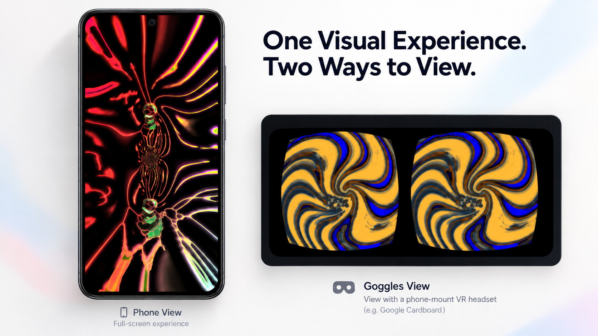

# Koggles

[](https://github.com/carterchadams/koggles/releases/download/current/koggles-current.apk)

Koggles is a music visualizer for Android, built for full-screen viewing and inexpensive phone-mount goggles. Watch the visuals respond to audio playing on your phone, or switch to **goggles mode** for a lens-corrected, side-by-side view in a mount such as Google Cardboard.

Powered by [projectM](https://github.com/projectM-visualizer/projectm), the open-source reimplementation of Winamp's MilkDrop, Koggles includes **299 presets** in its Starter Pack, along with the MilkDrop texture pack. Explore the bundled collection, add your own preset packs, and mark favorites within each pack.



[**Download APK**](https://github.com/carterchadams/koggles/releases/download/current/koggles-current.apk) · [Releases](https://github.com/carterchadams/koggles/releases) · [Case study: design and AI-assisted development](CASE_STUDY.md)

**Photosensitivity warning:** The visualizations contain intense moving and flashing lights. The app also presents a warning on first launch, before requesting audio access.

## Install

**Requirements:** Android 10 (API 29) or newer on a 64-bit ARM (arm64) device. Goggles mode is designed for Cardboard-compatible phone mounts.

Koggles is currently in prerelease. It has been developed and checked on a Samsung Galaxy S25 FE; testing on a wider range of phones and mounts is still needed.

Download the [latest APK](https://github.com/carterchadams/koggles/releases/download/current/koggles-current.apk) and open it on your phone. When prompted, allow installation from the browser or file manager opening the file, then confirm the install.

Release APKs use the same signing key, so newer releases install over older ones. A debug build signed with a different key must be uninstalled first.

<details>
<summary>Checksums and release files</summary>

To check a versioned download against its published SHA-256 checksum, download the APK and its matching `.sha256` file from the same release into one directory. Run the following, replacing `vX.Y.Z` with the version you downloaded:

```sh
sha256sum -c koggles-vX.Y.Z.apk.sha256
```

The `current` download link is refreshed with each release. [Versioned releases](https://github.com/carterchadams/koggles/releases) also include checksums, the R8 mapping for crash reports, and the complete corresponding source with submodules included.

</details>

## Using Koggles

### Playback and presets

Play audio on your phone, then open Koggles. **Tap once** to move to the next preset, or let presets advance automatically at your chosen interval. **Double-tap** to open the menu for playback, preset packs and browsing, display settings, the library, and audio options.

To add your own collections, choose a primary folder on your device. Its subfolders become preset packages—for example, `Documents/Koggles/<pack>/…`. Select the packages you want to use and mark favorite presets within them. Collections stay as ordinary folders, so you can manage them through the filesystem.

### Goggles and lens spacing

Goggles mode uses Google's Cardboard SDK for lens correction and viewer profiles. Scan your mount's QR code to load its profile; without one, Koggles uses the Cardboard v1 profile.

**Wide view** extends the picture toward the screen edges rather than stopping at the viewer's nominal field of view. **Wide + window** also gives each eye its own side of the frame. Each view keeps its own lens-spacing setting, with defaults calculated from the phone and viewer profile.

Choose **Configure spacing with volume buttons** to display two bullseyes, one for each eye. Use the phone's volume buttons to adjust their spacing while looking through the headset. To return to the visuals, double-tap the screen or, if your mount has a trigger, press it twice. Back also works.

**Testing status:** Wide, Wide + window and the spacing calibration have been checked hands-on in the headset. On a Galaxy S25 FE (Android 16), normal mode and goggles mode (Wide + window, distortion correction on) both run at the panel's full 120 fps with no dropped frames, measured over 20 s from SurfaceFlinger's frame timestamps (present-to-present p95 8.69 ms).

### Audio and permissions

Koggles uses device audio only and offers two capture modes:

- **Standard** requires one ordinary Android permission and does not require fresh playback-capture consent after locking the phone.
- **High quality** is opt-in, captures playback directly, and requires system consent. Some apps block capture. On Android 15 and newer, locking the phone ends the capture session, so Koggles asks for consent again when you return.

How the visuals respond can vary by phone, audio route, and the app playing the audio. After 10 seconds without detected audio, Koggles displays a hint. If another app is using the audio visualizer, Koggles reports the conflict and retries until it becomes available.

### Privacy

Koggles sends nothing anywhere unless you turn on **Share anonymous usage statistics** on the first screen or in the menu's Privacy section. The switch is off on every new install.

With it on, the app sends event counts to [Aptabase](https://aptabase.com), hosted in the United States: app started, session length in minutes, goggles mode on or off, wide view mode, viewer QR scanned, spacing calibration finished. Each event carries your phone model, Android version, app version and build number, language, whether the build is a debug build, the analytics library's version, a timestamp, and a random session ID that changes after an hour without use or when the app restarts. Aptabase derives your country from your IP address and a daily-changing anonymous hash to estimate how many people use the app; it does not store the IP address. No account, no advertising ID, no audio, no preset names, no file paths.

Turn the switch off at any time and nothing more is sent; an event accepted just before you did may still be delivered once the network allows. Aptabase keeps analytics data for up to five years. It cannot be linked back to you, which also means it cannot be deleted on request. The exact list of events and fields is pinned by the tests `EventTest` and `AptabaseTransportTest`.

## Build from source

Prerequisites:

- JDK 21.
- Android SDK at `$HOME/Android/Sdk` (or `ANDROID_HOME`) with `platforms;android-36`, `platforms;android-35`, `build-tools;36.0.0`, `ndk;29.0.14206865`, `cmake;3.22.1`, and `platform-tools`.

```bash
git clone --recursive https://github.com/carterchadams/koggles.git
cd koggles
source tools/env.sh            # Sets JAVA_HOME, ANDROID_HOME, and PATH
./gradlew :app:installDebug     # Builds and installs on a connected phone or emulator
```

The first build fetches bundled presets and textures from pinned upstream commits, verifies every preset against `app/bundled-presets.txt` by SHA-256, and builds the Cardboard SDK from its submodule.

### Signed release builds

To sign a release with your own keystore, create a `keystore.properties` file at the repository root:

```properties
storeFile=/path/to/koggles-release.jks
storePassword=YOUR_KEYSTORE_PASSWORD
keyAlias=koggles
keyPassword=YOUR_KEY_PASSWORD
```

The file is gitignored and must never be committed. Build with:

```sh
./gradlew :app:assembleRelease
```

Without `keystore.properties`, the release APK is left unsigned and the build prints a warning. See [RELEASING.md](RELEASING.md) for the publishing process.

## Tests

| Suite | Command |
|---|---|
| Unit | `./gradlew :app:testDebugUnitTest` |
| Instrumented, on a device or emulator | `./gradlew :app:connectedDebugAndroidTest` |
| Host C++, with ThreadSanitizer (TSAN) | `cmake -S native-tests -B build/host-tests && cmake --build build/host-tests -j && ctest --test-dir build/host-tests` |
| Bundled-preset sweep | `tools/ci/preset-sweep.sh` |
| Bundled-preset shader validation | `tools/ci/preset-sweep.sh --shaders` |

Preset sweeps are separate from the instrumented suite. The shader check enables projectM diagnostics to distinguish successful compilation from a fallback shader. Release-tooling checks are in the scripts matching `tools/ci/test-*.sh`.

For device work, `-PkogglesAppIdSuffix=.sweep` installs a build alongside the main app. `-PkogglesShaderDiagnostics` enables and captures projectM's preset-debug output. `-PkogglesAptabaseKey=<key>` builds in an Aptabase app key; without one the analytics switch is hidden and nothing is ever sent, which is how every plain CI build and every fork builds (the key is public but deliberately not in the repository; see RELEASING.md).

## Replacing libprojectM

projectM is LGPL-2.1 and ships as a separate shared library at `lib/arm64-v8a/libprojectM-4.so`. To build with a modified version:

1. Unpack a release's `koggles-vX.Y.Z-source.tar.gz`, which includes the exact projectM revision under `third_party/projectm`.
2. Make your changes in `third_party/projectm`.
3. Configure your own signing key in `keystore.properties` and run `./gradlew :app:assembleRelease`.

The rebuilt APK carries your signing key, not the project's release key.

## Credits and licenses

- **Koggles:** MIT; see [LICENSE](LICENSE).
- **projectM:** LGPL-2.1, used unmodified as a shared library. The corresponding source ships with every release.
- **Google Cardboard SDK:** Apache-2.0.
- **Koggles Starter Pack presets:** selected from projectM's [classic preset pack](https://github.com/projectM-visualizer/presets-projectm-classic), whose repository states no license. They are distributed under the projectM team's statement that MilkDrop presets are safe to treat as public domain and that it removes presets on request (`LICENSE.md` in its `presets-cream-of-the-crop` repository). The app quotes this statement verbatim in `assets/licenses/koggles-starter-pack-presets.md`.
- **MilkDrop texture pack:** textures shipped with MilkDrop, plus others used by presets. The pack states no license.

License texts and bundled-content notices are available in the app under **Library → About & licenses**.
